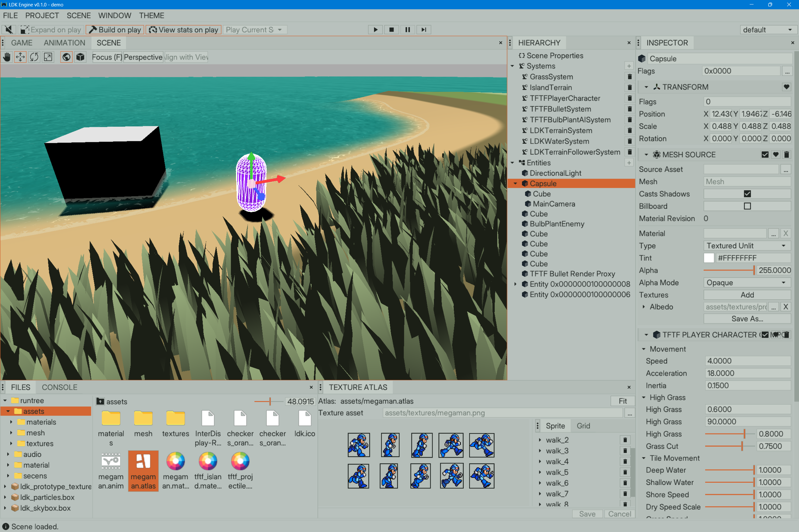

# Projects

Most of my personal projects started because I needed something, wanted to understand how something worked, or simply wasn't happy with the tools available.

Some are things I use every day. Others began as experiments and became useful along the way.

---

## LDK

LDK is a 3D game engine I'm building from scratch in C, primarily for my own games.

It has an entity-component system, an integrated editor, rendering, asset management, and tools for building game projects. The editor and the runtime use the same underlying systems, and game code is just C code.

I'm not trying to build a universal engine. I want an engine where I can understand what's going on, change things when they don't work, and avoid adding abstractions just to hide the ones already there.

It's still a work in progress, and that's part of the fun.

[Source code](https://github.com/marciovmf/ldk)
[Documentation](https://handmadegame.dev/ldk)

---

## STDX

A few years ago I decided to use C instead of C++ for my personal projects. I quickly found myself writing the same basic utilities over and over again.

STDX is what came out of that: a collection of small, independent, single-header C99 libraries for memory management, containers, strings, filesystems, threading, networking, and other common tasks.

It's not an attempt to turn C into something else. I just wanted a set of tools that made writing C more convenient without getting in the way. These days, most of my other projects are built on top of it.

[Source code](https://github.com/marciovmf/stdx) | [Documentation](https://handmadegame.dev/stdx/) | [Article](https://handmadegame.dev/stdx_my_standard_c_library.html)

---

## Slab

Slab is a small static site generator written in C, built using STDX and Minima.

I had already written a static site generator before, but after building Minima I wanted to try using it in a real application. A site generator turned out to be a good excuse.

Instead of inventing a complicated template language, Slab uses Minima to execute the templates. The result is a small command-line tool that takes Markdown, HTML, and templates and produces a static website.

This blog is generated with Slab.

[Source code](https://github.com/marciovmf/stdx/tree/main/demo/slab) | [Article](https://handmadegame.dev/slab_a_minima_static_site_generator.html)

---

## Minima

Minima is a tiny scripting language designed to be embedded in C applications.

It started as a way to put STDX through its paces. An interpreter seemed like a good way to exercise parsing, memory management, and data structures all at once. Then it turned out to be useful for more than testing.

The basic idea is that everything is a command. Even things like `if` and `foreach` are commands, not special language constructs. Applications can add their own commands without changing the parser or inventing another layer of syntax.

[Source code](https://github.com/marciovmf/stdx/tree/main/demo/minima) | [Article](https://handmadegame.dev/minima_a_tiny_command_language_you_can_embedd_anywhere.html)

---

## Doxter

Doxter is a documentation generator for C projects. It reads source files, extracts documentation comments, and generates static HTML pages.

Like Minima, it started as a demo for STDX. I wanted a real application to test the library, but I didn't see much point in writing something I would never use again.

Doxter doesn't try to understand every corner of C. It follows a small set of conventions, keeps the documentation next to the code, and stays out of the way.

It's also the tool used to generate STDX's documentation.

[Source code](https://github.com/marciovmf/stdx/tree/main/demo/doxter) | [Documentation example](https://handmadegame.dev/stdx/) | [Article](https://handmadegame.dev/doxter_no_nonsense_c_documentation_generator.html)
